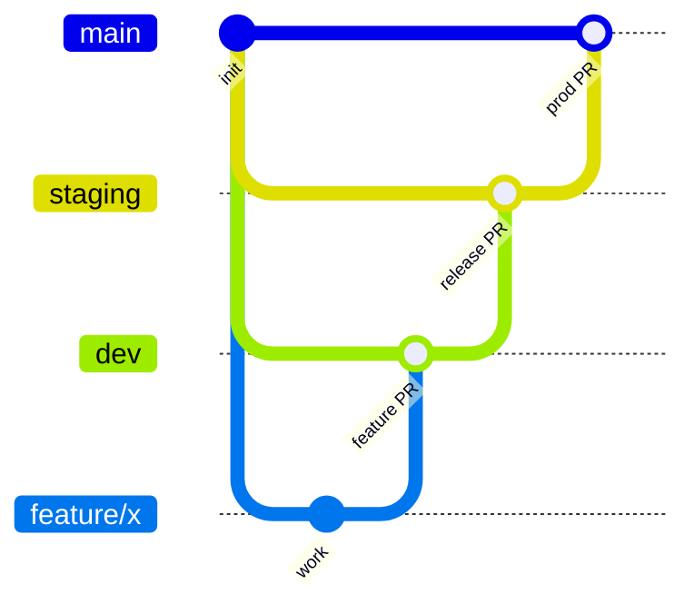

# MLOPS-PROJECT

Final-year project: machine learning in production.
SMS spam classifier trained on the UCI SMS Spam Collection (CC BY 4.0).

**Live app:** https://sms-spam-detector-gdlg.onrender.com · **MLflow:** https://dagshub.com/iiDaVoDkA/MLOPS-PROJECT.mlflow

## Team

- Hassen Ben Amor
- Dalil Adimi

## Branch flow

- `feature/*`: short-lived, branched from `dev`, merged into `dev` by reviewed PR (**merge commit**).
- `dev` → `staging` → `main`: promoted by PR (**merge commit**).
- `main`, `staging` and `dev` are protected: changes go through a PR with 1 approval, and force pushes and deletions are blocked. Required CI checks will be added with the CI workflow.

## Workflow triggers

| Workflow | Trigger | What it does |
|---|---|---|
| ci.yml | PR to dev / staging / main | lint-test: ruff + pytest · docker: image build + container smoke test against an offline test registry |
| staging.yml | push to staging | pytest · image build + container smoke test · push `ghcr.io/iidavodka/mlops-project:<sha>` |
| deploy.yml | push to main | verify + push the image · deploy that exact image to Render · live smoke test (expected image + champion version). See [DEPLOYMENT.md](DEPLOYMENT.md) |
| ct.yml | manual (workflow_dispatch) | pipeline: validate data, score champion, retrain if the rule triggers, promote if gates pass, restart + verify live · rollback: move champion to an approved version, restart + verify live. See [DEPLOYMENT.md](DEPLOYMENT.md#continuous-training) |